<p align="center">
  
</p>

<p align="center">
  
</p>

<p align="center">
  <a href="https://www.linkedin.com/in/sami-sabarna/"></a>
</p>

---

### ⚡ What I do

I design and ship **intelligent automation end to end**: I map a business process, then turn it into software that runs by itself. That means RPA bots, BPM workflows, low-code apps and AI agents wired into the systems a company already uses.

- 🤖 **RPA & BPM:** Blue Prism digital workers and Appian processes, built for real operations rather than demos.
- 🧠 **Applied AI:** LLM agents, document AI, speech (ASR / TTS) and retrieval over company knowledge.
- 🔗 **Integration:** APIs, webhooks, ERPs and queues, so data moves between systems with no copy-paste.
- ⚙️ **Ops-ready delivery:** containers, CI/CD, scheduling, monitoring and alerts, so automations keep running after go-live.

### 🧰 Toolbox

<p>
  
  
  
  
  
  
  
  
  
  
  
  
  
  
</p>

### 🚀 Featured builds

| | Project | What it does |
|---|---|---|
| 🎬 | **[Yaqeen](https://github.com/SamiSabarna/yaqeen)** | A fully automated content channel. A Python and headless-browser pipeline renders Arabic/English short videos; a scheduler publishes them to YouTube, Instagram, Facebook and TikTok (n8n, GitHub Actions, YouTube Data API, Buffer), with retries, alerts and no double posting. |
| 🧠 | **Enterprise AI Assistant** *(private POC)* | A knowledge assistant, document AI and voice in one platform for enterprise teams. |
| 🌐 | **SENVRA** *(private)* | A bilingual technology website with secure content administration. |
| 🌐 | **99 (٩٩)** *(private)* | A bilingual (Arabic / English) business website. |

### 🧭 How I work

```text
discover the process  →  design the flow  →  automate (RPA · BPM · AI)  →  integrate  →  monitor & improve
```

### 🤝 Let's connect

<p>
  <a href="https://www.linkedin.com/in/sami-sabarna/"></a>
</p>

---

<p align="center">
  <i>Have a process that eats hours every week? Let's automate it.</i>
</p>
